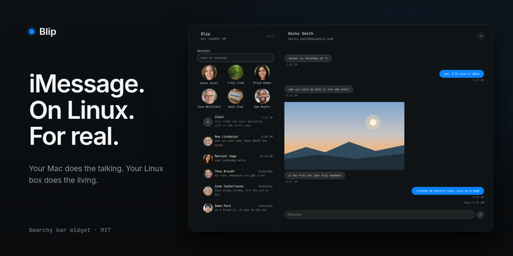

<p align="center">
  
</p>

# blip.technology

The one-page site for [Blip](https://github.com/nixfred/blip), an Omarchy bar widget that puts iMessage in the bar. Read, send, groups, blue dots. Your Mac is the gateway, Linux is the client. Part of [nixfred.com](https://nixfred.com/).

<p align="center">
  
</p>

The image above is the project's own promo graphic. It uses invented people and example.com addresses only.

## Status

Live at https://blip.technology/ on Cloudflare Pages (project `blip-technology`, direct upload with wrangler). The visual design is provisional and not yet approved. All design tokens live in one file, `src/site.css`, so a re-skin is a one-file change.

## Build

Needs [bun](https://bun.sh). No runtime dependencies.

```bash
bun build.ts          # fetch GitHub stats, write dist/
bun build.ts --stats-only
python3 -m http.server 8080 --directory dist
python3 tools/verify.py   # links, assets, dashes, overflow, screenshots (needs playwright and Chrome)
```

The build never fails when the GitHub fetch fails and `src/data/github-stats.json` is committed. Set `GITHUB_TOKEN` to avoid rate limits. Star, fork and contributor numbers are always rendered from that JSON, never typed into HTML.

## Layout

- `src/content.ts`: all copy, taken from the public Blip README and manifest
- `src/site.css`, `src/site.js`: styles and the small script (Copy button, WebMCP tool)
- `src/public/`: logo and favicon masters from `nixfred/nixfredOS` brand (byte copies, never edited), Kanit 500 font, `blip-og.png`
- `src/public/assets/`: demo screenshots copied from the Blip repo (`docs/img/`), all rendered with invented data
- `src/skills/`: agent skills, rendered into `/.well-known/agent-skills/` with sha256 digests
- `build.ts`: the build script
- `dist/`: build output (ignored by git)

## Images

Every image on the site is either a brand file or a Blip demo graphic. The Blip README states that its screenshots are the real client rendered against invented people, with numbers in the 555-0100 range reserved for fiction. No image shows a real conversation, contact, phone number, email address or hostname.

## Agent readiness

`/index.md` is a static markdown copy of the page. `robots.txt` carries a Content-Signal line. `_headers` adds Link headers, security headers and cache rules. `/.well-known/agent-skills/index.json` lists one skill, `install-blip`. A feature-detected WebMCP tool, `get_install_instructions`, returns the install commands. There are no Pages Functions.

## Licenses

Kanit is licensed under the SIL Open Font License, see `src/public/fonts/OFL.txt`. Blip itself is MIT licensed.
