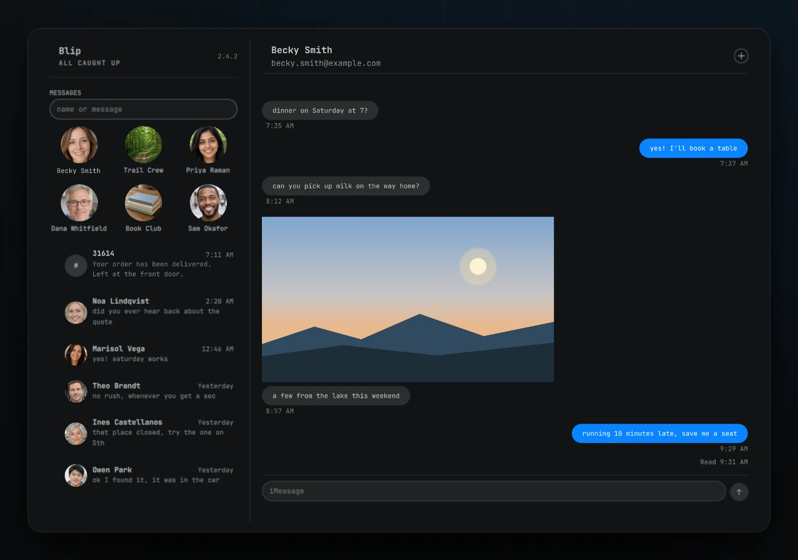

<p align="center">
  
</p>

# blip.technology

The one-page site for [Blip](https://github.com/nixfred/blip), an Omarchy bar widget that puts iMessage in the bar. Read, send, groups, blue dots. Your Mac is the gateway, Linux is the client. Part of [nixfred.com](https://nixfred.com/).

<p align="center">
  
</p>

The image above is the Blip card shown on nixfred.com. It uses invented people and example.com addresses only.

## Status

Live at https://blip.technology/ on Cloudflare Pages (project `blip-technology`, direct upload with wrangler). The visual design is provisional and not yet approved. All design tokens live in one file, `src/site.css`, so a re-skin is a one-file change.

## Build

Needs [bun](https://bun.sh). No runtime dependencies.

```bash
bun build.ts          # fetch GitHub stats and contributors, write dist/
bun build.ts --stats-only
python3 -m http.server 8080 --directory dist
python3 tools/verify.py   # links, assets, dashes, overflow, screenshots (needs playwright and Chrome)
```

The build never fails when the GitHub fetch fails and `src/data/github-stats.json` is committed. Set `GITHUB_TOKEN` to avoid rate limits. Star and fork numbers are always rendered from that JSON, never typed into HTML. The same rule holds for contributors: `tools/contributors.ts` reads the merged PRs, the commit contributors and the project's `CONTRIBUTORS-X.md` from GitHub, drops bots, and falls back to the committed `src/data/contributors.json` and `src/data/avatars/` when GitHub cannot be reached.

## Layout

- `src/content.ts`: all copy, taken from the public Blip README and manifest
- `src/site.css`, `src/site.js`: styles and the small script (Copy button, WebMCP tool)
- `src/public/`: logo and favicon masters from `nixfred/nixfredOS` brand (byte copies, never edited), Kanit 500 font, `blip-og.png`
- `src/public/assets/`: the showcase image (`blip-showcase.webp`, cropped from the Blip card) and four scene illustrations (`blip-bar-popout`, `blip-group-chat`, `blip-toast`, `blip-share-sheet`), all with invented data
- `design/`: the HTML and CSS sources of the four scenes and the Playwright script that renders them at 2x (`design/mocks/gen.py`, `render.py`)
- `src/data/`: `github-stats.json`, `contributors.json` (fetched fallback), `contributor-notes.json` (hand written write ups, each cited to merged PRs), `quotes.json` (X posts, verbatim, each with its exact URL), `avatars/` (GitHub avatars at 96 px, self hosted)
- `tools/`: `verify.py` and `contributors.ts`
- `src/skills/`: agent skills, rendered into `/.well-known/agent-skills/` with sha256 digests
- `build.ts`: the build script
- `dist/`: build output (ignored by git)

## Images

Every image on the site is a brand file, the Blip card graphic, one of four scene illustrations drawn in the same style, or a contributor's public GitHub avatar. The card and the scenes use invented people, example.com addresses and numbers in the 555-0100 range reserved for fiction. The scenes are illustrations of the interface, not screenshots of the shipping client, and the page says so. No image shows a real conversation, contact, phone number, email address or hostname. `blip-og.png` is the same card window and stays the social image.

## Agent readiness

`/index.md` is a static markdown copy of the page. `robots.txt` carries a Content-Signal line. `_headers` adds Link headers, security headers and cache rules. `/.well-known/agent-skills/index.json` lists one skill, `install-blip`. A feature-detected WebMCP tool, `get_install_instructions`, returns the install commands. There are no Pages Functions.

## Licenses

Kanit is licensed under the SIL Open Font License, see `src/public/fonts/OFL.txt`. Blip itself is MIT licensed.
